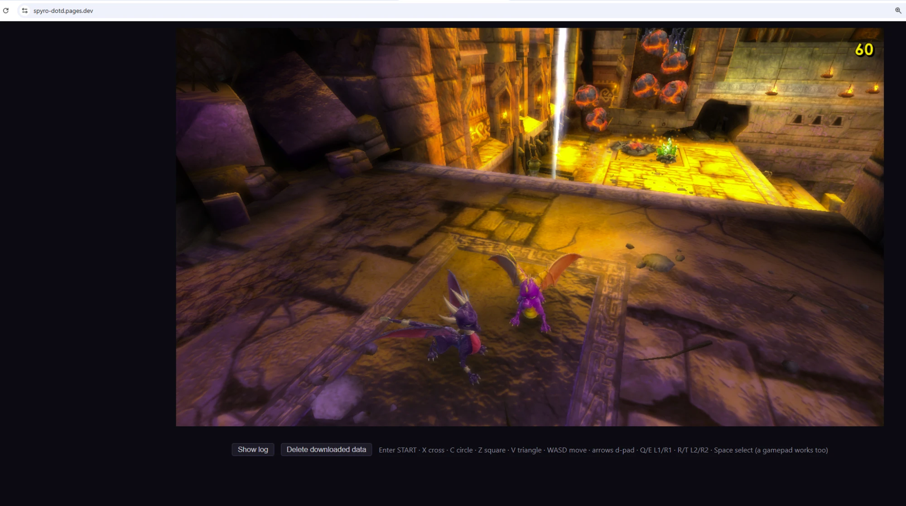

**Every tracked engine/game function is ported** (16,444; 2026-11-17). LVL010 and LVL020 replay frame-exact against recordings of the original; the rest of the game is playable but not yet checked frame by frame.

# Dawn of the Dragon remake (work in progress)



A behaviour-exact reimplementation of *The Legend of Spyro: Dawn of the Dragon*
(PS3, BLUS30205). This repository contains the `dotd` source, tests, build
configuration, documentation and the build/run tools. It builds as a native
Windows executable and as a WebAssembly + WebGL2 page.

## Play it on Windows

1. Download this repository (a git clone or the zip).
2. Double-click **`launcher.cmd`**. The launcher (a plain Windows window, nothing to install):
   - **Game:** (the button before the folder): your copy of the game, the disc dump's folder (the one holding
     `PS3_GAME`) or a decrypted `.iso` (copied out once to `%LOCALAPPDATA%\dotd\game`); it checks the files
     (`dotd.exe --check-game`).
   - **Start**: starts `dotd.exe`, building it the first time (several minutes: it offers to install the free Visual
     Studio Build Tools with winget when there is no C++ compiler, and CMake downloads the SDL and FFmpeg **source**
     archives itself, each checked by SHA-256). The game's log shows in the window; the button turns into **Stop**
     while the game runs. **Build** brings `dotd.exe` up to date after the source changes.
   - **Graphics** and **Game**: resolution, full screen (borderless or exclusive), MSAA with smooth leaves
     (alpha-to-coverage), FXAA, frame rate, vsync, the FPS counter, language and confirm button, saved to `dotd.ini`
     (next to `dotd.exe`) as soon as they change.
   - **Controls...**: the keyboard key of every pad button and stick direction, set the way RPCS3 does it (click a
     button, press the key). Gamepads need no setup.
3. Command-line options (`dotd.exe --msaa 8`) are for starting `dotd.exe` by hand from `build/windows-msvc/Release`;
   most have a `dotd.ini` line too, which the launcher writes.

In the game: **F11** (or Alt+Enter) full screen, Shift+F11 borderless or exclusive; **F3** steps MSAA, Shift+F3
FXAA, Ctrl+F3 alpha-to-coverage; F2 switches the 60 fps cap. `--resolution 2560x1440` renders more pixels (16:9
sizes keep the original picture exactly, other aspects widen the view). An unknown or malformed option is reported,
never silently ignored.

You need your own **BLUS30205** (USA) disc dump. The disc's encrypted `EBOOT.BIN` is enough: the port decrypts it
in memory to read the game's shaders (`src/platform/self_decrypt.h`), so RPCS3 is not needed. A decrypted
`EBOOT.elf` is used when it is there. Game files are only ever read. An encrypted (redump-style) `.iso` must be
decrypted with its disc key first, or use a folder dump.

## Build by hand

Requires CMake 3.25 or newer, Ninja, and Visual Studio with the C++ tools.
Run these commands from an x64 Visual Studio developer command prompt:

```sh
cmake --preset windows-msvc
cmake --build --preset windows-msvc-release
```

The executable is `build/windows-msvc/Release/dotd.exe`.
For a debug build and tests:

```sh
cmake --build --preset windows-msvc-debug
ctest --preset windows-msvc-debug
```

SDL3 (a submodule) and FFmpeg 7.1.2 (Bink video/audio, ATRAC3 speech) are downloaded as source at configure time
when they are missing; `git submodule update --init` or a local FFmpeg clone in `thirdparty/ffmpeg` are used instead
when present. A build without FFmpeg is refused unless `-DDOTD_NO_VIDEO=ON` asks for one. See
[thirdparty/README.md](thirdparty/README.md) for dependency details.

`tools\build_release.bat` does the configure and Release build in one step
(it finds Visual Studio with vswhere), and `tools\run_release.bat` starts the
result. Keyboard: RPCS3's default pad layout (Enter START, X cross, C circle,
Z square, V triangle, WASD move, arrows d-pad, Q/E L1/R1, R/T L2/R2, Space
select), changed with the launcher's Controls dialog or `key_<button>` lines in
`dotd.ini`; a gamepad works too. `--fps N` (or `fps = N` in `dotd.ini`) unlocks
the frame rate; the default 60 is the original's timing.

## Web build (WebAssembly + WebGL2)

The same game code compiled with Emscripten. `tools\build_wasm.bat` builds it
into `build/wasm` and `tools\run_wasm.bat` serves it on `http://localhost:8080/`,
reading the game files from your own `USRDIR`. `tools\pack_wasm.bat` and
`tools\run_wasm_download.bat` make and try a static-site folder whose page
downloads the game data level by level. The zstd source is needed for that mode
(see [thirdparty/README.md](thirdparty/README.md)). Details are in
[web/README.md](web/README.md).

## Game data

Supply your own copy of the game (the launcher's **Game:** button does the rest). By hand: copy `dotd.ini.example` to `dotd.ini` in the
working directory or next to the executable, and set `usrdir` to your local `PS3_GAME/USRDIR` directory. Game data is
read only. Tests requiring it skip when it is not configured.

Game data, binaries, screenshots, build output and local settings are excluded
from this repository. The reverse-engineering workspace and its Git history
are kept separately.

## Source layout

- `src/k2000/` and `src/Spyro2008/`: reconstructed engine and game code.
- `src/Renderware/`: the RenderWare portions used by the remake.
- `src/crt/`: math, random-number and PPC instruction helpers.
- `src/platform/`: platform replacements for the PS3 imports.
- `web/`: the web page, its local server and the site packer.
- `tools/`: Windows build and run launchers.
- `tests/`: native tests; `docs/`: implementation plans and coding rules.

## Credits and acknowledgements

- **Étranges Libellules** for the original game and its **K/Kal engine**, and **Sierra Entertainment** for publishing it.
- **AdrienTD** for [XXL-Editor](https://github.com/AdrienTD/XXL-Editor) and [elbtools](https://github.com/AdrienTD/elbtools), which helped explain the engine's classes and file formats.
- **Criterion Software** for **RenderWare 3.7.0.2**, the [SIGMA source archive](https://github.com/sigmaco/rwsrc-v3.7.0.2) maintainers, and **aap and contributors** for [librw](https://github.com/aap/librw).
- **OSome Studio / Microids** and the original **Étranges Libellules** developers for the *Asterix & Obelix XXL 2* Mac debug symbols used to recover original engine names.
- **clienthax** for [Ps3GhidraScripts](https://github.com/clienthax/Ps3GhidraScripts), and **ps3dev / PSL1GHT contributors** for the [open PS3 SDK references](https://github.com/ps3dev/PSL1GHT).
- **SDL** and **FFmpeg** contributors for the native platform, video, and audio dependencies.

See [the full credits](docs/CREDITS.md) for RPCS3, Ghidra and its MCP bridge, ReClass.NET and its MCP bridge, NVIDIA Cg, PS3 SDK references, the overlay/mod projects, and the build/analysis tools, with links and details of their use.
